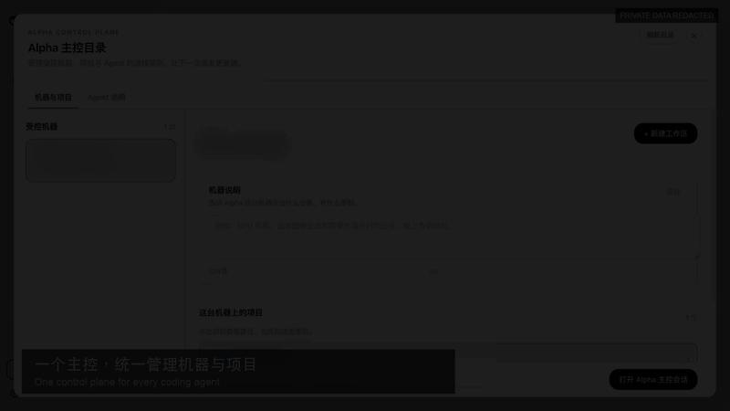

# dsh-alpha

English | [简体中文](README.zh-CN.md) · [Live site](https://songofhawk.github.io/dsh-alpha/) · [Architecture](docs/design.md)

> A control plane for dispatching coding work across machines and agent runtimes from one DSH conversation.

_The demo uses an isolated environment. Machine, workspace, and path information is redacted._

The square launch film on the [project site](https://songofhawk.github.io/dsh-alpha/) was rendered locally with the open-source HyperFrames framework.

## Why dsh-alpha

Coding agents are useful on their own, but real work quickly spreads across laptops, build hosts, GPU machines, and repositories that live at different paths. dsh-alpha adds the missing control plane:

- see which machines and agents are online;
- treat the same Git repository on different machines as one logical workspace;
- route a task to the right machine, runtime, model, and permission mode;
- stream progress, approvals, cancellation, and results back into the same conversation;
- reconnect and recover durable task history when a Worker temporarily disappears.

dsh-alpha is a plugin for [DSH (DeepSeek Harness)](https://github.com/deepseek-ai/dsh). It coordinates existing provider CLIs; it does not replace their installation, authentication, or security controls.

## Mental model

~~~text
DSH Web / headless master
  ├─ global workspace inventory
  ├─ agent capability and load catalog
  ├─ task / approval / recovery state
  └─ reverse WebSocket gateway
          ├─ Worker A → Codex / Claude Code
          ├─ Worker B → Kimi Code / ZCode
          └─ Worker C → OpenCode / Qoder / WorkBuddy
~~~

Workers connect outward to the master, so they do not need public IP addresses. Repository identity is separated from machine-local paths, and execution remains constrained to each Worker's explicit allowed roots.

## Highlights

| Capability | What it changes |
| --- | --- |
| Global workspace inventory | One repository can be recognized across several machines and local paths. |
| Repository-aware scheduling | Prefer a Worker that already has the repository; clone on demand only inside an allowed root. |
| Per-turn Worker controls | Select Agent, model, reasoning effort, and permission mode without leaving the conversation. |
| Event-driven results | Dispatch once, wait on events, and resume with the same durable task ID after interruption. |
| Approval handoff | Worker approval requests return to the active Alpha session instead of hanging invisibly. |
| Reverse gateway | Workers connect to the master through authenticated WebSocket sessions and reconnect automatically. |
| Operational tooling | Web sidebar, headless runner, status CLI, Worker doctor, and multi-device acceptance checklist. |

## Quick start

### Requirements

- Node.js 22.13 or newer (task events use the built-in SQLite module)
- DSH `0.2.1-rc.5` or newer
- pnpm (used by `dsh plugin`)
- the provider CLI you want to run, already installed and authenticated on the machine that executes it

~~~bash
dsh --version
pnpm --version
~~~

### DSH Web

~~~bash
dsh plugin --profile web add dsh-alpha
node ~/.dsh/profiles/web/node_modules/dsh-alpha/scripts/install-preset.mjs
dsh web
~~~

Open **Alpha master** from the Web sidebar, choose a workspace or keep automatic routing enabled, then start a conversation.

For account login, use DSH `0.2.1-rc.5` or newer and run `dsh-alpha login-setup` as the master user. Behind an HTTPS proxy, set `DSH_ALPHA_LOGIN_ORIGIN=https://your-domain` and restart the master. A single administrator account supports login and logout; registration is unavailable. Keep Cloudflare DNS and Tunnel mappings, and remove the target Access policy only after verifying account login. See the [deployment guide](docs/deployment.md).

### Headless master

~~~bash
dsh plugin --profile alpha add dsh-alpha
node ~/.dsh/profiles/alpha/node_modules/dsh-alpha/scripts/install-alpha-profile.mjs
dsh --profile alpha "Use list_agents, dispatch a short task, and report the result."
~~~

The installer updates only the dsh-alpha managed block and preserves configuration outside it.

### Optional Jev routing

Set `TYPESAFE_API_KEY` and `DSH_ALPHA_JEV_ROUTING=1` in the master process to let Jev choose the workspace, Agent, and model for new requests without an Agent selected in the UI. A selected Agent still dispatches directly. The task engine continues to enforce the UI scope, model capabilities, filesystem boundaries, and approvals. Uncertain decisions, timeouts, and service failures fall back to the existing master LLM.

Keep the key in the master environment, outside the repository. `DSH_ALPHA_JEV_ENDPOINT` can point to an HTTPS service implementing the full TypeSafe `v1/systemone` Choice response, including `choice`, `confidence`, and `probabilities`. The confidence thresholds are provisional; assess routing accuracy, fallback rate, and latency on representative requests before rollout.

For source testing, load the local configuration with `node --env-file=.env`. Placing `.env` in the directory alone does not change the environment of a running master process.

### Develop from source

~~~bash
git clone https://github.com/songofhawk/dsh-alpha.git
cd dsh-alpha
npm install
npm run setup
npm test
~~~

## Alpha main session

The sidebar **Alpha** entry opens one long-lived main session (the `alpha-router` preset). Keep typing in it: each message is attributed to a task and the work runs in the background, so the conversation is never blocked by a running task.

- **Attribution** runs in three tiers: deterministic rules (`#12`, the task detail box, the per-message selector), then the Jev decision model, then the master LLM. Every decision is recorded and can be corrected with **Move** in the task view.
- **After install you land in the Alpha full-page UI by default**: a task rail on the left, the conversation or a task's detail on the right. "Back to DSH" at the top of the rail returns to the host's original UI; "Enter Alpha" beside the input box or in the sidebar brings you back. Progress on a task never moves the screen by itself.
- **The conversation is IM-style**: one chronological stream with no token-by-token output. Your messages, Alpha's replies and Worker reports are each a complete message; every message of yours carries a `→ #12 task` tag (click to open, "Reassign" if it landed wrong), and pending approvals sit as cards above the input. You can send images and text files (paperclip, drag in, or paste), and "Quote" under any message puts your next message in the same **topic** (an unassigned message is circled into a "Discussing" topic).
- **Topics, not tickets**: the UI has one concept, the topic. A topic may be only a discussion or have work dispatched; there is no mandatory acceptance. A Worker reply is an ordinary message, "Collapse" tucks a topic away, and topics idle for 7 days collapse automatically (`DSH_ALPHA_ARCHIVE_DAYS`, 0 disables) and reopen on a new message. A "Discussing" topic only collects messages until you press "Start work" or tell Alpha to go ahead; Alpha may also circle consecutive messages about the same undecided matter into one such topic.
- **The topic rail** groups by "Task by [status ▾]": status, project, type, or machine, with what needs you first. Types are not preset: Alpha grows them from the tasks you give it and reuses existing ones where it can; you can create, rename and merge them. Approvals can only be decided with UI buttons (the approval card above the chat input, or in the task detail).
- **Continuity**: follow-ups resume the same runtime session where the runtime supports it, join the running turn where it supports steering, and otherwise rebuild context from the task record. After a master restart, unfinished tasks continue on their own.
- **Selectors are per-message** in the main session: they constrain the next message and then clear.

Decision-model attribution is off by default because it sends task titles, summaries, and recent messages to Jev. Set `DSH_ALPHA_JEV_ATTRIBUTION=1` with `TYPESAFE_API_KEY` to enable it; without it, messages that no deterministic rule can place go to the master LLM. Measure it first with `node --env-file=.env scripts/eval-attribution.mjs --jev`, which sends the labelled fixtures to Jev.

The classic **Alpha master** session (`alpha` preset, `dispatch_task` / `wait_task`) is unchanged and still available from the control directory.

## Add a remote Worker

Configure one token per Worker on the master:

~~~bash
export DSH_ALPHA_GATEWAY_HOST=0.0.0.0
export DSH_ALPHA_GATEWAY_PORT=4310
export DSH_ALPHA_GATEWAY_TOKENS='build-1:replace-with-a-long-random-token'
~~~

Install and start the Worker on the target machine:

~~~bash
npm install dsh-alpha

export DSH_ALPHA_HUB_URL='ws://<master>:4310/'
export DSH_ALPHA_WORKER_MACHINE_ID='build-1'
export DSH_ALPHA_WORKER_TOKEN='replace-with-a-long-random-token'
export DSH_ALPHA_WORKER_ALLOWED_ROOTS='/work'

./node_modules/.bin/dsh-alpha-worker-doctor
./node_modules/.bin/dsh-alpha-worker
~~~

Use `wss://` and network-level source restrictions outside a trusted LAN or VPN. Keep tokens out of repositories, URLs, screenshots, and process logs.

## Supported runtimes

The default scans every supported runtime and advertises those with an available executable. `DSH_ALPHA_WORKER_PROVIDERS` is an optional override to restrict candidates.

| Provider ID | Runtime | Discovery |
| --- | --- | --- |
| `codex` | Codex app server / CLI | Automatic |
| `claude-code` | Claude Code headless | Automatic |
| `kimi-code` | Kimi ACP | Automatic |
| `dsh` | DSH headless profile | Automatic |
| `zcode` | Zhipu ZCode headless | Automatic |
| `opencode` | OpenCode ACP | Automatic |
| `qoder` | Qoder headless | Automatic |
| `workbuddy` | Tencent WorkBuddy via codebuddy | Automatic |

Automatic discovery checks executable availability; each runtime still needs separate authentication and a real-task check. `mock` exists for tests and local diagnostics only.

The `dsh` provider runs `dsh --profile headless` in the Worker's target directory and uses that machine's headless profile default model. This entry point returns final text only; per-turn model overrides and forwarding DSH's internal approvals to the master are not yet supported.

## Daily workflow

1. `list_workspaces` resolves the logical repository and its machine locations.
2. `list_agents` exposes availability, capabilities, load, and workspace affinity.
3. `dispatch_task` returns a durable `taskId`; `wait_task` follows the event stream without busy polling.
4. `agent_approve` or `agent_cancel` resolves Worker approvals in the current Alpha session.
5. `task_status` and `task_result` recover disconnected or historical work.

The Web workspace selector can create a hard machine/workspace constraint. With no manual selection, the scheduler may choose a matching Worker and clone the Git workspace into its allowed root.

## Safety defaults

- Gateway startup fails closed when authentication tokens are missing.
- Every local and remote path is checked against explicit allowed roots.
- Clone destinations are chosen by the Worker, never by an arbitrary task path.
- Web master and headless master must not share one gateway port.
- Health endpoints expose liveness and Worker counts, not identities or secrets.
- Worker doctor is read-only and never prints the Worker token.
- Approval, cancellation, reconnect, and interrupted-task behavior are covered by automated tests.

## Useful commands

~~~bash
dsh-alpha status
dsh-alpha web
dsh-alpha run "summarize the current workspace"
dsh-alpha-worker-doctor
dsh-alpha-worker
npm test
~~~

## Documentation

- [Design and architecture](docs/design.md)
- [Deployment guide](docs/deployment.md)
- [Multi-device acceptance checklist](docs/multi-device-acceptance.md)
- [LAN access bundle](packages/dsh-lan-access/README.md)
- [Vendored adapter notes](src/adapters/vendor/README.md)
- [Launch article: Chinese](site/article.zh-CN.md) / [English](site/article.en.md)
- Doco publication: [Chinese](https://doco.page/s/k2KWDVuEhWMDUA5mGpf_nUd7hMI_Um-u) / [English](https://doco.page/s/WBbyHRtlsfr1lhwr_iDTLQbpdSXL0QeM)

## Project status

Current public source version: **0.2.1**. The repository covers local orchestration, reverse-gateway Workers, repository-aware scheduling, recursive masters, approval forwarding, global workspace selection, durable task recovery, and seven production runtime integrations.

Before upgrading a running installation, rerun the matching preset/profile installer and execute the acceptance checklist for every connected machine.
